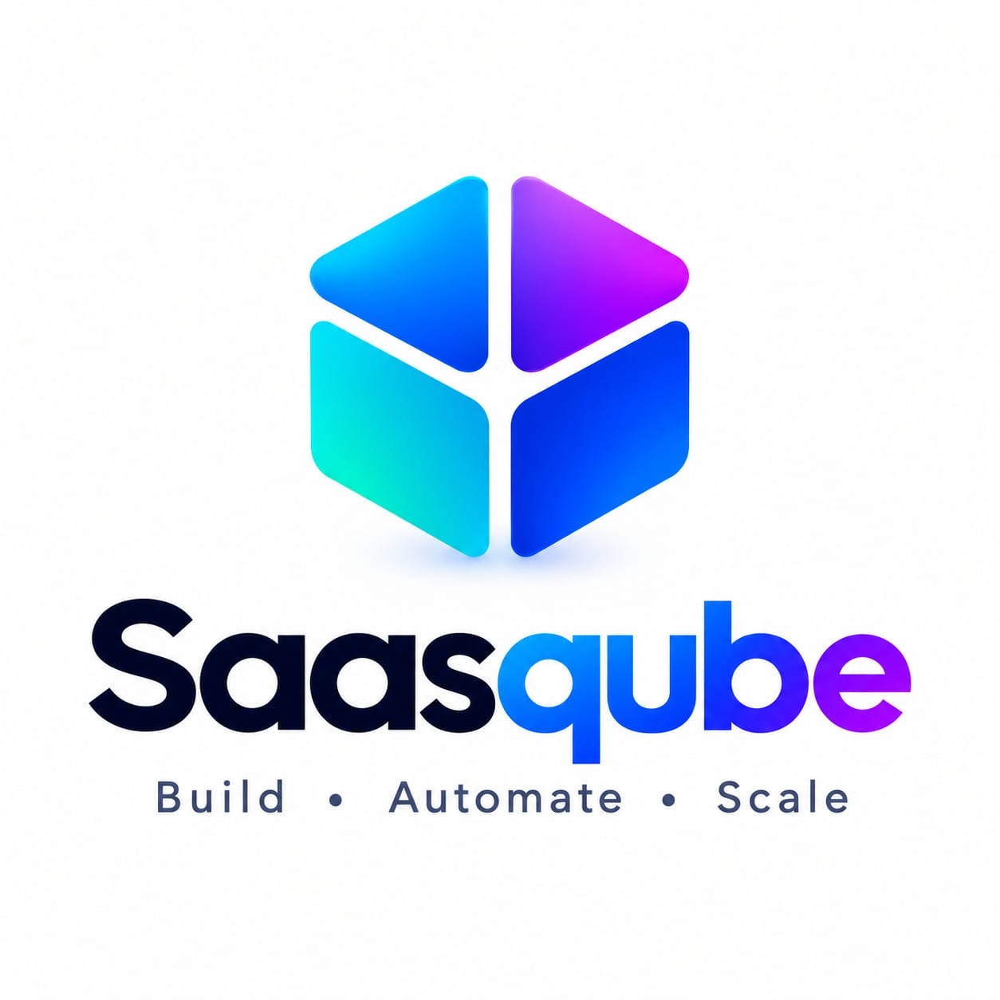
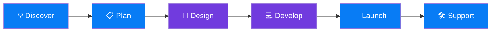

# 🚀 SaaSQube Solutions

### Build. Automate. Scale.

**We transform business ideas into powerful digital experiences.**

SaaSQube Solutions is a technology-driven website design and development company based in Tamil Nadu, India. We help businesses establish their digital presence through modern websites, custom web applications, e-commerce platforms, ERP solutions and business automation.

<p align="center">
  
</p>

<p align="center">
  <a href="https://saasqube.tech">🌐 Website</a> •
  <a href="https://saasqube.tech/templates/">🎨 Explore Demos</a> •
  <a href="https://wa.me/917397063122">💬 Contact Us</a>
</p>

---

## 💡 What We Do

We build digital solutions that make businesses smarter, faster and more scalable.

| Service | Description |
|---|---|
| 🌐 Website Development | Modern, responsive and professional business websites |
| 💻 Web Applications | Custom web-based applications and dashboards |
| 📱 Mobile Apps | Android and iPhone apps for bookings, orders and loyalty |
| 🛒 E-commerce Solutions | Online stores and digital commerce platforms |
| 🧾 ERP & Billing Software | Business management and billing solutions |
| 🎨 UI/UX Design | Modern, intuitive and user-friendly experiences |
| ⚙️ Business Automation | Smart digital workflows and process automation |
| 🛠️ Custom Software | Tailored technology solutions for businesses |

---

## 🎨 Explore Our Website Templates

Discover our collection of industry-specific website demos, designed to help businesses visualize their digital presence.

| Industry | Live Demo |
|---|---|
| 💊 Pharmacy | [Explore Demo](templates/pharmacy/) |
| 🍽️ Restaurant | [Explore Demo](templates/restaurant/) |
| 🏥 Hospital | [Explore Demo](templates/hospital/) |
| 🧪 Labs & Scans | [Explore Demo](templates/labs-scans/) |
| 🎂 Bakery | [Explore Demo](templates/bakery/) |
| 💇 Salon & Spa | [Explore Demo](templates/salon/) |
| 🎓 School & College | [Explore Demo](templates/school/) |
| 💪 Gym & Fitness | [Explore Demo](templates/gym/) |
| 🏡 Real Estate | [Explore Demo](templates/real-estate/) |
| 📱 Mobile Shop | [Explore Demo](templates/mobile-shop/) |
| 📸 Photography & Films | [Explore Demo](templates/photography/) |
| 👗 Fashion & Clothing | [Explore Demo](templates/fashion/) |
| ☕ Café | [Explore Demo](templates/cafe/) |
| 💍 Jewellery | [Explore Demo](templates/jewellery/) |

**Have a business? Let's build a website for it.**

---

## ✨ Why SaaSQube?

- 🎯 Business-focused digital solutions.
- 🎨 Modern and creative UI/UX.
- 📱 Mobile-first responsive development.
- ⚡ Performance-focused websites.
- 🔧 Customizable and scalable solutions.
- 🤝 Dedicated development and support.

---

## 🛠️ Technology Stack

<p align="center">
  
</p>

---

## 🔄 Our Development Process



---

## 🌍 Our Mission

To empower businesses with accessible, innovative and reliable digital solutions that simplify operations, improve customer experiences and accelerate growth.

## 🔮 Our Vision

To become a trusted technology partner for businesses by combining creativity, engineering and innovation.

---

## 📬 Let's Build Something Great Together!

Have an idea, a business or a project in mind?

Let's turn it into a digital experience.

<p align="center">
  <a href="https://saasqube.tech">🌐 Visit Our Website</a>
  &nbsp; | &nbsp;
  <a href="https://wa.me/917397063122">💬 WhatsApp</a>
  &nbsp; | &nbsp;
  <a href="mailto:sales@saasqube.tech">✉️ Email Us</a>
</p>

<p align="center">
  <b>SaaSQube Solutions</b><br/>
  Build · Automate · Scale 🚀
</p>

---

## 🛠️ Developer notes

### Structure

```
index.html        Single-page site: hero, services, templates, problems we solve, pricing, FAQ, contact
404.html          Not-found page
css/style.css     All styles (light + dark theme, responsive down to small phones).
                  Brand colours from the logo live in :root: --cyan, --brand (blue), --accent (purple), --grad
css/home.css      Homepage design (v2): floating pill header, rotating hero, stacked service cards, dark bands
js/home.js        Homepage extras: rotating hero word, "What do you need?" chips feeding the contact form
js/theme.js       Light / dark theme switch (shared by the homepage and templates gallery)
js/main.js        Contact details, mobile menu, scroll effects, template slider, contact form
js/loader.js, js/cube.js, js/motion.js, css/motion.css
                  Intro loader, 3D cube and scroll / hover motion effects
assets/
  logo-mark.svg     The cube mark (used in the header, footer and About section)
  saasqube-logo.jpg Original full logo (cube, wordmark and "Build · Automate · Scale")
  logo-email.png    PNG logo used in the EmailJS emails
  favicon.svg
emailjs/          HTML for the EmailJS enquiry and auto-reply templates
templates/        Industry demo websites to show clients (see below)
```

### Website templates (client demos)

`templates/index.html` is a gallery page with live previews of fourteen demo websites, each for a fictional business with its own look:

| Folder | Industry | Highlights |
|---|---|---|
| `pharmacy/` | Pharmacy / medical shop | Prescription upload, categories, offers, store locator |
| `restaurant/` | Restaurant / café | Tabbed menu with ₹ prices, veg/non-veg marks, gallery, reservations |
| `hospital/` | Hospital / clinic | Appointment booking, departments, doctors, health packages |
| `labs-scans/` | Diagnostic lab & scan centre | Test search, health packages, home sample collection, X-ray/CT/MRI prices, report download |
| `bakery/` | Bakery / cake shop | Bestsellers, custom cake order form, eggless tags |
| `salon/` | Salon & spa | Service price list, bridal packages, team, booking |
| `school/` | School / college | Admissions, academics, facilities, notice board |
| `gym/` | Gym & fitness | Plans, class schedule, BMI calculator, free trial |
| `real-estate/` | Builders & realty | Property filters, amenities, EMI calculator, site visits |
| `mobile-shop/` | Mobile phone shop | Phones with EMI, accessories, repair prices, exchange value estimator |
| `photography/` | Photography & videography | Portfolio gallery with filters, wedding packages, date booking |
| `fashion/` | Fashion & clothing boutique | Shop by category, new arrivals (women / men / kids), offers, tailoring |
| `cafe/` | Café & coffee shop | Tabbed menu with ₹ prices and veg marks, work-friendly perks, events, table booking |
| `jewellery/` | Jewellery store | Today's gold rate, collections, savings scheme calculator, appointments |

The **mobile shop** template uses real photos in `templates/mobile-shop/img/`, downloaded from [Unsplash](https://unsplash.com/license) (free for commercial use, no attribution required; credited in the template footer anyway), except the Galaxy S-series, Nord CE and Galaxy A-series product images, which are manufacturer product renders added by the team (`assets/*5G*`, optimised copies in `img/`): store display by Jason Leung, iPhone 15 Pro by Thai Nguyen, earbuds by atelierbyvineeth, USB-C cable by Marcus Urbenz, smartwatch by Artur Łuczka, phone cases by Behar Zenuni and phone repair by PR MEDIA. The **bakery** template also uses Unsplash photos, in `templates/bakery/img/`: bakery display by Kirsten Drew, bakery counter by Elisha Terada, chocolate cake by David Holifield, strawberry gateau by Léo Roza, croissants by Hannah Fleming-Hlll and Raymond Petrik, cookies by Oleg Bersenev and Girl with red hat, red velvet cupcakes by Owen Bruce and Zayed Ahmed Zadu, breads by Bon Vivant and Wesual Click, and the birthday cake by David Trinks. All other templates now use free Unsplash photos too, stored in each template's own `img/` folder (restaurant, café, pharmacy, hospital, labs & scans, salon, school, gym, real estate, fashion, jewellery, photography). Each template footer credits Unsplash; the Unsplash License allows commercial use without attribution. People in the photos are not the fictional staff named in the demos: doctor cards keep initials, and stylist and coach cards show the work (hands, equipment) rather than faces, so swap in the client's real team photos when you customise a template.

All templates share `templates/shared.css` and `templates/shared.js` (header, mobile menu, forms, tabs, footer). Each sets its own colours and fonts in a `<style>` block at the top. Every template has a dark bar at the top linking back to the gallery, plus a **Get this website** button. That button opens the main site's contact form with the template already filled in (`index.html?template=Name#contact`). The bar is hidden automatically when a template is shown as a preview in the gallery.

Forms in the templates are demo-only: they show a thank-you message and don't send anything. To turn a template into a client's real site, copy its folder, replace the names, contact details and content, swap the drawn / gradient visuals for real photos, and remove the demo bar.

### Light / dark theme

The sliding sun / moon switch in the header changes the site between light and dark. The choice is saved in the visitor's browser and applies to the homepage, the templates gallery and the 404 page. Light is the default for everyone; dark is used only after a visitor picks it. Dark colours are defined in `css/style.css` under `:root[data-theme="dark"]`. The demo templates keep their own designs.

### Updating CSS or JS

Pages load `css/style.css`, `js/*.js` and the templates' `shared.css` / `shared.js` with a `?v=` version tag so visitors' browsers don't keep an old copy. After changing one of those files, bump the date in the tag (search for `?v=`).

### Run locally

Open `index.html` in a browser, or serve the folder:

```bash
python3 -m http.server 8080
# then visit http://localhost:8080
```

### Before going live: things to update

1. **Contact details.** These live in the `CONTACT` object at the top of `js/main.js` (currently +91 7397-063122, WhatsApp 917397063122, sales@saasqube.tech). Every phone, email and WhatsApp link on the page is filled from there; the same values are also written into `index.html` so the links work with JavaScript off, and into `emailjs/auto-reply-template.html`. Change all three places if they ever change.
2. **Pricing.** The packages in the `#pricing` section are starting points; adjust them to your real rates.
3. **SEO.** Update the `<title>`, `<meta name="description">` and the JSON-LD block in `index.html` with your exact city/address, and add a `<link rel="canonical">` once you have a domain.

### How the contact form works

The form has two buttons:

- **Send on WhatsApp** opens WhatsApp with the visitor's answers, addressed to your number.
- **Send by email** sends the enquiry straight to your inbox through [EmailJS](https://www.emailjs.com/). Email is required, and every visitor gets a thank-you copy at that address.

EmailJS settings are in the `EMAILJS` object at the top of `js/main.js`:

| Setting | Where to find it in EmailJS |
|---|---|
| `serviceId` | Email Services → your service |
| `templateId` | Email Templates → enquiry template → Settings |
| `autoReplyTemplateId` | Email Templates → auto-reply template → Settings (optional) |
| `publicKey` | Account → General → Public Key |

If `templateId` or `publicKey` is ever emptied, **Send by email** falls back to opening the visitor's email app. The HTML for both email templates is in `emailjs/`. Variables sent to EmailJS: `name`, `phone`, `email`, `reply_to`, `business`, `city`, `service`, `message` (empty optional fields are sent as "—"). Don't also turn on EmailJS's own Auto-Reply tab, or visitors get two thank-you emails. A hidden spam-trap field quietly drops submissions from bots.

### Social links

- Instagram: https://www.instagram.com/saasqube/ (footer, structured data `sameAs`, llms.txt).
- LinkedIn: the footer icon points to a placeholder, `https://www.linkedin.com/company/saasqube/`. Once the company page exists, update that URL in `index.html` and add it to `sameAs` in the JSON-LD.

### SEO

- `robots.txt`, `sitemap.xml` and `llms.txt` live in the site root. Add any new public page to `sitemap.xml` and update its `<lastmod>`.
- Structured data (JSON-LD) is in the `<head>` of `index.html` (Organization, WebSite, ProfessionalService with services and prices) and `templates/index.html` (CollectionPage). Update prices there if the pricing section changes.
- The share image for WhatsApp / LinkedIn / X is `assets/og-image.jpg` (1200×630).
- Demo templates are `noindex` on purpose (fictional businesses).
- The intro loader plays once per browser session to keep repeat page loads fast.
- Latest audit and action plan: `seo-audit/`.

### Deploy

Any static host works: GitHub Pages, Netlify, Vercel, Cloudflare Pages, Render static sites, or ordinary shared hosting (upload the files to `public_html`).

For **GitHub Pages**: repository *Settings → Pages → Deploy from a branch*, choose the branch and `/ (root)`.
